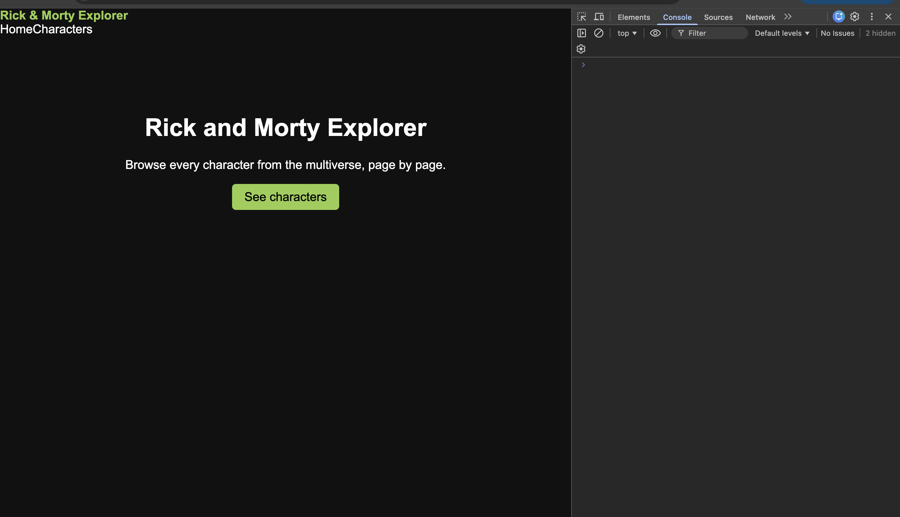
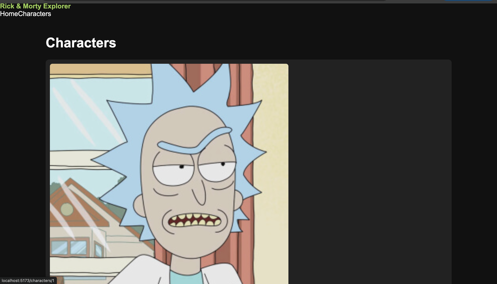

# React + Vite Project

## Problem Statement
- **PS Number:** 04

## Project Name
Rick and Morty Explorer

## About the Project
This project is built using React.js and Vite. It aims to solve the problem described in the selected problem statement through a simple and user-friendly web application.

## Technologies Used
- React.js
- Vite
- JavaScript
- HTML and CSS

## APIs Used
- **API Name:** Add the APIs used in your project.
- **Purpose:** Briefly explain what each API does.

## API Routes

| Method | Route | Description |
|---|---|---|
| GET | `/api/example` | Fetch data |
| POST | `/api/example` | Create data |
| PUT | `/api/example/:id` | Update data |
| DELETE | `/api/example/:id` | Delete data |

*Update this table according to your actual backend routes.*

## Screenshots

### Screenshot 1 — Home Page



### Screenshot 2 — Main Feature


## Live Demo
[View Live Project](YOUR_DEPLOYED_LINK)

## Installation and Setup

1. Clone the repository.
2. Install dependencies:

   ```bash
   npm install
   ```

3. Start the development server:

   ```bash
   npm run dev
   ```

4. Open the local URL shown in your terminal.

## Author
ANSHIKA GUPTA
